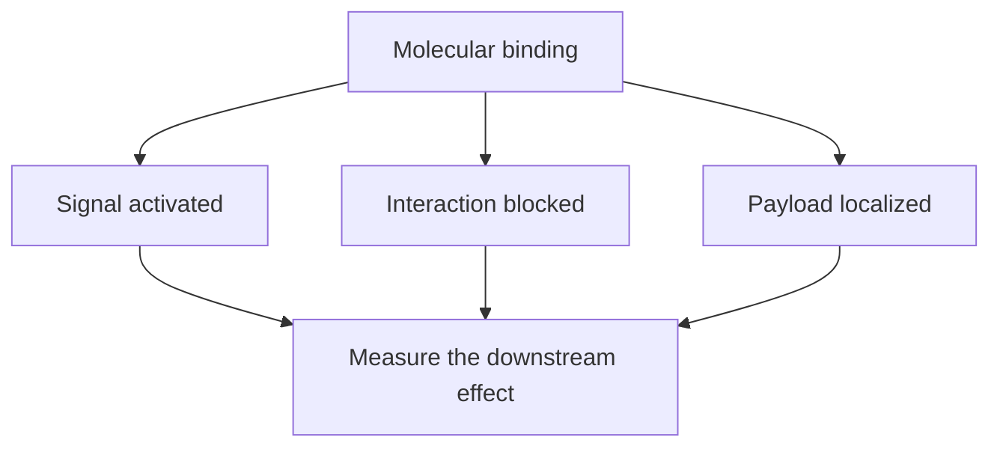

# Ligands and receptors

**You will be able to:** Explain why binding, signaling and delivering a payload are different functions.

A **ligand** is a molecule that binds a receptor or another defined binding partner. Binding may activate a signal, block it or deliver something. It does not always activate a receptor, and a binding interaction does not always produce the intended biological effect.

## The useful analogy and its limit

A key and lock suggest selective recognition. Real molecular surfaces are flexible: binding strength varies, several molecules may bind the same site, and one ligand can have more than one partner. The analogy explains recognition better than it explains what happens afterward.

*Binding is the beginning of a mechanism, rather than proof of its final effect.*

## Three examples

| Interaction | What binds | What changes |
|---|---|---|
| PD-L1 (programmed death-ligand 1) and PD-1 | A checkpoint ligand and a receptor on immune cells | Inhibitory signaling can limit T-cell responses |
| Anti-PD-1 antibody and PD-1 | A therapeutic antibody and its target | Blocks an inhibitory interaction; benefit still depends on immune and clinical context |
| Targeting binder and an accessible protein | A drug's recognition component and its target | Can localize a chemical or radiation payload without the target being a growth driver |

FAP, for example, is a cell-surface protease that can be a targeting address. Calling it a receptor that turns on a tumor-killing signal confuses delivery with signaling.

## Two cancer-relevant distinctions

**HER2 has no known direct ligand.** It can participate in signaling pairs with other receptors in its family, including ligand-bound partners. A textbook diagram should not depict a generic growth factor binding directly to HER2. HER2 staining and ADC (antibody-drug conjugate) eligibility are also separate from proving that a tumor depends on HER2 signaling.

**A TCR (T-cell receptor) recognizes peptide plus HLA (human leukocyte antigen).** For conventional T cells, the relevant binding partner is a peptide–HLA complex, not a free neoantigen peptide or an intact intracellular protein. Many receptors can recognize related complexes, and recognition still needs functional context.

## Try it

An antibody binds a tumor protein. Has it been shown to stop tumor growth?

**Explain it back:** No. Binding may localize the antibody, but signaling blockade, immune recruitment or payload delivery must be demonstrated. Safety and patient benefit require further evidence.

## Explain it back

Ask what binds, what changes after binding and which downstream effect was measured.

## Takeaway

**Ask what binds, what changes after binding and which downstream effect was measured.**

**Next:** [HLA](/wiki/education/concepts/immunology/antigen-presentation/hla), [dendritic cells](/wiki/education/oncology-101/2-dendritic-cells) and [targeted-therapy mechanisms](/wiki/education/targeted-therapy-modalities/01-mechanism).

## Sources

Checked October 8, 2026.

- [HER2–HER3 structural study](https://pubmed.ncbi.nlm.nih.gov/34819318/) — ligand binding and receptor partnership are different.
- [FDA tebentafusp review](https://www.accessdata.fda.gov/drugsatfda_docs/nda/2022/761228Orig1s000ChemR.pdf) — peptide–HLA recognition by a TCR-based drug.
- [NCI: monoclonal antibodies](https://www.cancer.gov/about-cancer/treatment/types/immunotherapy/monoclonal-antibodies).
