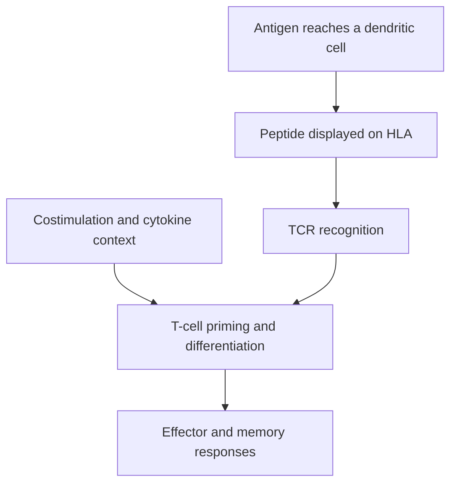

# Dendritic cells and T-cell priming

**You will be able to:** Distinguish presenting an antigen from activating a naive T cell.

**Dendritic cells (DCs)** are professional antigen-presenting cells with a central role in initiating T-cell responses. They can collect antigen, process it, display peptides and supply the additional signals needed for priming. A tumor cell displaying a peptide is not equivalent to a dendritic cell activating a naive T cell.

**Before starting:** [HLA](/wiki/education/concepts/immunology/antigen-presentation/hla) explains the display molecules; [TCR recognition](/wiki/education/molecular-profiling/tcr-and-tcr-sequencing) explains the reader.

## Antigen presentation and priming

**Presentation** means displaying a peptide on an HLA (human leukocyte antigen) molecule. **Priming** means the initial activation and differentiation of a naive T cell by suitable antigen and supporting signals. Professional antigen-presenting cells include dendritic cells, B cells and macrophages; dendritic cells are especially important for naive T-cell priming. “Only dendritic cells can ever present or prime” is too absolute.

*Antigen recognition alone does not determine the response.*

## Three signals

| Signal | Plain-language role | Important limit |
|---|---|---|
| Peptide–HLA recognition by TCR (T-cell receptor) | Identifies what the response is directed against | Not every displayed peptide is recognized |
| Costimulation, such as CD80/CD86 interacting with CD28 | Helps support activation | Missing or inhibitory signals can favor nonresponse or tolerance |
| Cytokine environment | Helps shape differentiation and function | Different cytokines and contexts produce different outcomes |

The three-signal model is a teaching framework. Real responses also depend on dose, timing, cell state, location and additional receptors. Dendritic-cell maturation is not one universal on/off switch.

## Cross-presentation versus direct presentation

Class-I HLA commonly displays peptides from proteins made within a cell. **Cross-presentation** routes an externally acquired antigen onto class-I HLA. It allows a dendritic cell to display tumor-derived material without being a tumor cell.

Conventional type-1 dendritic cells, **cDC1**, are particularly important in this pathway. Other subsets have different and overlapping functions. Cross-presentation is not exclusive to one cell type in every experimental setting.

For an RNA vaccine, an antigen-presenting cell may receive RNA and produce the encoded protein itself. That creates a route to **direct presentation** as well as pathways involving antigen transfer and cross-presentation. It is inaccurate to say that every RNA vaccine must first cross-present external tumor debris. Delivery chemistry and route matter.

## Why this matters in cancer

Tumor-derived signals can alter DC recruitment, maturation and migration. The presence of antigen or of T cells alone does not show the full chain is functioning. Conversely, a low DC count in a small specimen cannot prove that no priming occurred elsewhere.

Chemotherapy or radiation can release antigens and danger signals, but the resulting immune effect is context-dependent. A mechanism does not establish that adding either treatment improves a vaccine or checkpoint regimen.

## Try it

A DC produces an antigen after receiving vaccine RNA. Must its class-I presentation be called cross-presentation?

**Explain it back:** No. Presentation of antigen produced within that cell can be direct presentation. Cross-presentation specifically concerns external antigen routed onto class I.

## Explain it back

Separate antigen display, initial priming and later tumor-cell recognition; a functioning response needs more than peptide availability.

## Takeaway

**Separate antigen display, initial priming and later tumor-cell recognition; a functioning response needs more than peptide availability.**

## Sources

Checked October 8, 2026.

- [Kranz et al., systemic RNA delivery to dendritic cells](https://pubmed.ncbi.nlm.nih.gov/27281205/) — primary delivery and immune-response experiments.
- [NCI: cancer treatment vaccines](https://www.cancer.gov/about-cancer/treatment/types/immunotherapy/cancer-treatment-vaccines).
- [TNBC-MERIT primary paper](https://www.nature.com/articles/s41586-025-10004-2) — a particular clinical RNA-lipoplex platform, not proof for every vaccine design.
