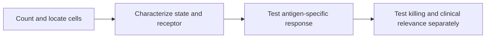

# T-cell states: presence and function

**You will be able to:** Explain why a T-cell count or checkpoint marker does not establish effective tumor killing.

T cells change state as they develop, encounter antigen and experience sustained stimulation. Their identity, receptor specificity, location and functional state are separate questions. A tumor containing many T cells may still lack effective tumor-directed killing.

**Before starting:** [Dendritic-cell priming](/wiki/education/oncology-101/2-dendritic-cells) and [TCR recognition](/wiki/education/molecular-profiling/tcr-and-tcr-sequencing).

## States to distinguish

| State | What the label describes | What it does not prove |
|---|---|---|
| Naive | A cell that has not yet undergone its initial antigen-driven activation | That a suitable tumor-reactive receptor will be present in a sample |
| Effector | Differentiated functions after activation, including cytotoxic activity in appropriate cells | That the recognized target is the cancer |
| Memory | Persistence after a response and potential for renewed response | Permanent protection or uniform behavior |
| Anergic | Antigen-related hyporesponsiveness, often involving inadequate supporting signals | The same mechanism as chronic-stimulation exhaustion |
| Exhausted | A differentiation program associated with persistent antigen and altered function | Complete silence, or a universal inability to respond to checkpoint blockade |
| Senescent | Restricted proliferative capacity and related cellular features | That every cytotoxic function is absent |

These are useful biological categories, not a deterministic timetable. Marker patterns overlap, and a single protein cannot assign a complete functional state.

## Anergy and exhaustion differ

Priming depends on antigen recognition and supporting signals. In some contexts, recognition without sufficient costimulation leads to anergy or tolerance. The outcome is not automatic every time a T cell contacts a tumor cell.

Exhaustion occurs under persistent stimulation and involves regulatory and epigenetic changes. Exhausted populations can contain **progenitor-like** cells with self-renewal capacity and more differentiated cells with restricted responses. Progenitor-like populations can help supply the expansion seen after PD-1 blockade; the exact behavior is context-dependent.

PD-1 expression also occurs during activation. “PD-1 positive” therefore does not mean “terminally exhausted,” and checkpoint blockade does not simply revive every inactive T cell. There is no fixed week-by-week sequence that identifies a patient's functional state.

## Measurement needs context

*Cell presence, state markers, antigen response and killing are different readouts.*

Flow cytometry measures selected proteins; RNA profiling describes expression programs; paired TCR (T-cell receptor) sequencing connects some programs to clonotypes. Cytokine assays such as ELISpot or intracellular cytokine staining test responses under defined stimulation. They do not directly establish tumor-cell killing. Spatial proximity also does not prove recognition.

## Implications for therapy

A vaccine depends on generating useful antigen-specific responses. A surface-target engager bypasses the need for native TCR specificity, but still requires suitable effector function and access. It does not bypass exhaustion or all cell-state constraints.

Engineering peripheral T cells with a CAR (chimeric antigen receptor) or TCR changes recognition and signaling. It does not guarantee a permanently functional population: engineered cells can also encounter suppression and become dysfunctional. Banking cells is a product-specific logistical option, not a standard universal rescue for chemotherapy-related repertoire changes.

## Try it

A biopsy contains PD-1-high CD8 cells next to tumor cells. Has effective tumor recognition been demonstrated?

**Explain it back:** No. The cells could be activated, exhausted, tumor-reactive or bystanders. More state and specificity evidence is needed, followed by functional testing.

## Explain it back

Ask who the cells recognize and what they do, in addition to how many are present.

## Takeaway

**Ask who the cells recognize and what they do, in addition to how many are present.**

## Sources

Checked October 8, 2026.

- [Siddiqui et al., exhausted T-cell subsets and checkpoint response](https://pubmed.ncbi.nlm.nih.gov/30778252/) — primary tumor experiments and melanoma observations.
- [Utzschneider et al., TCF1 and chronic-infection responses](https://pubmed.ncbi.nlm.nih.gov/27533016/) — primary mechanistic work in a distinct disease context.
- [NCI: T-cell transfer therapy](https://www.cancer.gov/about-cancer/treatment/types/immunotherapy/t-cell-transfer-therapy).
