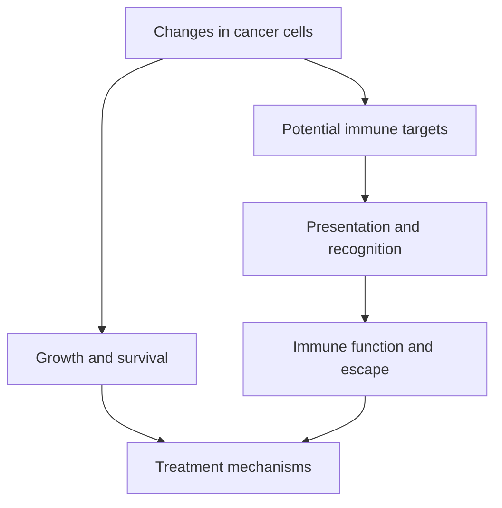

# Oncology 101 — the minimum vocabulary

**Explain how cancer growth, immune recognition and treatment mechanisms fit together.**

Start here when terms such as antigen or checkpoint feel unfamiliar. No specialist training is assumed. The lessons introduce mechanisms; they do not select an individual treatment.

## The big ideas

1. Cancer cells acquire changes that disrupt control of growth and survival.
2. A tumor contains different cancer-cell populations and normal neighboring cells.
3. Immune recognition needs more than immune cells being present.
4. Medicines and local treatments act through different mechanisms.

## The map

## Lessons

| Lesson | Question | Minutes |
|---|---|---|
| [Ligands and receptors](/wiki/education/oncology-101/1-ligands) | How do cells send and receive signals? | 8 |
| [Dendritic cells](/wiki/education/oncology-101/2-dendritic-cells) | How does an immune response begin? | 8 |
| [T-cell states](/wiki/education/oncology-101/3-t-cell-states) | Why can recognition fail to produce effective killing? | 8 |
| [Escape mechanisms](/wiki/education/oncology-101/4-escape-mechanisms) | How can the route used by a therapy fail? | 10 |
| [Standard treatment](/wiki/education/guides/treating-early-tnbc/index) | What are the different jobs of medicines, surgery and radiation? | 12 |

## Cancer is a change in control

Cancer is genetic in the sense that acquired DNA changes can drive it. It is not necessarily inherited. Changes in gene regulation and the tissue environment also matter. Cells that survive treatment can differ from the cells that were initially dominant. This variation is called tumor heterogeneity.

A useful general model is uncontrolled growth combined with failure of normal restraints. It does not mean every tumor has the same mutation or depends on the same protein. A tumor sample also contains immune cells, fibroblasts and vessels; their signals can contribute to a measurement.

## Recognition is a chain

Human leukocyte antigen (HLA) molecules display short protein fragments. A T-cell receptor (TCR) contacts a peptide–HLA complex. A mutated peptide can be a potential neoantigen, but mutation alone does not establish its display, recognition or safe targeting.

Shared HLA alleles occur in many people; a person's inherited combination is personal rather than necessarily unique. Loss of one allele differs from loss of all conventional class-I display. Natural killer (NK) cells integrate inhibitory and activating signals; missing HLA alone does not guarantee tumor killing.

Checkpoint antibodies can relieve selected inhibitory signals. They do not manufacture a missing target or guarantee reversal of every exhausted cell state. Vaccines and engineered cells have their own target and evidence requirements. Investigational mechanisms are hypotheses until appropriate studies establish their clinical role.

## Concepts you will use

[[wiki/education/concepts/immunology/antigen-presentation/hla|HLA]], [[wiki/education/concepts/breast-cancer/surgery-and-pathology-results/pcr|pathologic complete response]], [[wiki/education/concepts/breast-cancer/surgery-and-pathology-results/residual-cancer-burden|residual cancer burden]] and [[wiki/education/concepts/evidence-and-statistics/biomarkers/prognostic-vs-predictive|biomarker evidence]].

## Applied to Diana

[[wiki/care/diagnosis|Diagnosis]], [[wiki/care/treatment-plan|the treatment plan]] and [[wiki/questions/is-tumor-hot|the immune-context question]] own the current findings and decisions. A general biology explanation cannot turn a proposed vendor product into a selected treatment.

## What is still uncertain

Mechanism, activity in a model and benefit in a clinical trial are distinct evidence levels. Which immune or molecular feature predicts added benefit from a particular investigational treatment remains a study-specific question.

## Try it

A sample contains many immune cells. Does that prove they recognize and kill the cancer?

**Answer:** No. Cell identity, location, receptor specificity and function are separate questions.

**Takeaway:** A plausible mechanism starts a question; measurement and clinical evidence determine what it can support.

## Sources and scope

Updated October 8, 2026; expert and learner review pending.

- [NCI: what is cancer?](https://www.cancer.gov/about-cancer/understanding/what-is-cancer).
- [NCI immunotherapy](https://www.cancer.gov/about-cancer/treatment/types/immunotherapy).
- [NCI immune checkpoint inhibitors](https://www.cancer.gov/about-cancer/treatment/types/immunotherapy/checkpoint-inhibitors).
