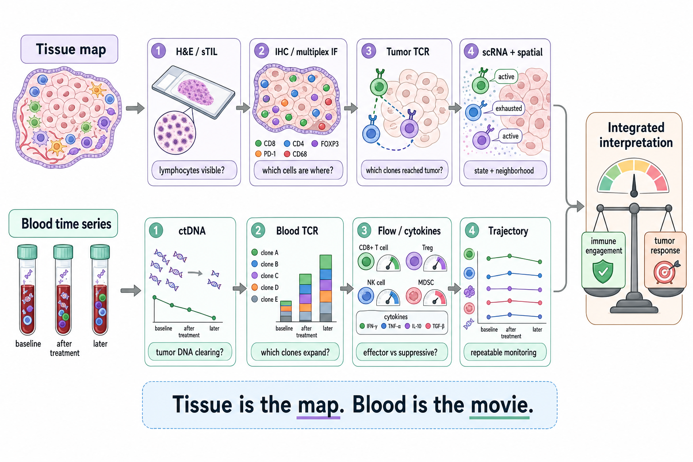
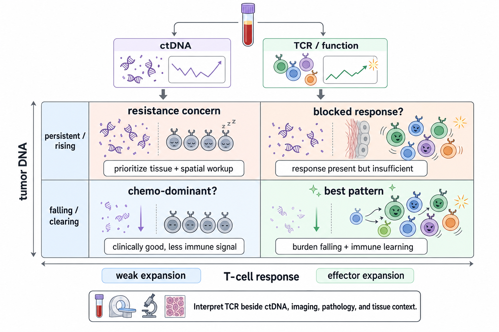

# Measuring T-cell engagement

This page is the practical ladder for a deceptively simple question:

> Are T cells seeing Diana's tumor, reaching it, and doing useful work?

No single assay answers that end-to-end. H&E can show lymphocytes in the tumor bed. Multiplex imaging can show which immune cells are next to tumor cells. [[about/Terminology#tcr-seq|TCR-seq]] can show whether T-cell clones are expanding in blood or tumor. [[about/Terminology#scrna-seq|Single-cell RNA sequencing]] can show whether those cells look activated, exhausted, suppressive, or irrelevant. [[about/Terminology#ctdna|ctDNA]] answers a different but paired question: is tumor-derived DNA clearing while the immune response is changing?

The useful mental model is: **location, identity, clonality, function, and tumor-burden response are separate layers.** Some require tissue; some are deliberately blood-first.

## The two-lane measurement strategy

Do not read this as "tissue first, blood later." Tissue and blood answer different questions and should ideally be collected in parallel. Tissue gives location and state; blood gives trajectory and repeatability.

## What each assay can and cannot tell you

| Readout | Sample | What it measures | Best use | Main limitation |
|---|---|---|---|---|
| **sTIL score** | H&E slide | Percent stromal area occupied by lymphocytes | Cheap baseline [pCR](/about/Terminology#pcr) / immune-inflamed signal | Does not identify CD8 vs Treg, tumor specificity, or killing |
| **IHC** | [FFPE](/about/Terminology#ffpe) slide | One protein marker per slide, such as CD8, FOXP3, PD-L1, HLA-I, B2M | Fast targeted confirmation | Marker-by-marker, limited spatial context |
| **Multiplex IF / MXIF** | [FFPE](/about/Terminology#ffpe) or fresh tissue slide | Many immune and tumor markers on the same slide | Hot vs excluded vs cold; CD8 proximity; Treg rings; HLA patchiness | Requires panel design and image analysis |
| **Tumor [TCR-seq](/about/Terminology#tcr-seq)** | Tumor tissue or TIL-rich section | TCR clonotypes physically present in tumor | Identifies clones that reached tumor | Sequence alone does not prove antigen target or cytotoxic function |
| **Blood [TCR-seq](/about/Terminology#tcr-seq)** | PBMCs, whole blood, or leukopak | Circulating TCR clonotypes and expansion over time | Longitudinal immune pharmacodynamics during pembro, local priming, or vaccine | Blood clones may not match tumor clones |
| **[scRNA-seq](/about/Terminology#scrna-seq)** | Fresh viable cells, sometimes nuclei | Cell-by-cell gene-expression state | Active vs exhausted T cells; Tregs; macrophages; rare populations | Tissue hungry; dissociation can bias cell recovery |
| **scTCR-seq** | Same single-cell prep | TCR sequence paired to each T cell's state | Links a clone to exhaustion, activation, memory, or Treg identity | Usually needs fresh tissue or high-quality cells |
| **Spatial transcriptomics** | Tissue section | Gene expression with location preserved | Maps immune programs to tumor/stroma neighborhoods | Platform-specific resolution and QC issues |
| **[ctDNA](/about/Terminology#ctdna)** | Plasma | Tumor-derived DNA burden over time | [MRD](/about/Terminology#mrd), response, recurrence-risk monitoring | Does not say whether T cells caused the tumor response |

## P-RAD, PEARL, and where blood fits

P-RAD and PEARL were tissue-first immune-readout studies.

**P-RAD TCI** was an early post-treatment biopsy readout: CD3/CD8 T-cell access into or around the tumor bed, measured by quantitative / multiplex immunofluorescence and summarized as an Immunoscore-style T-cell infiltration metric. It asked whether T cells were physically present in the tumor architecture soon after pembrolizumab plus radiation.

**PEARL TIL reduction** was a pathology-style percent TIL readout across serial [[about/Terminology#fresh-frozen|fresh-frozen]] tumor biopsies: baseline, after pembrolizumab alone, and after pembrolizumab plus radiation. It asked whether mean TIL scores changed over those tissue timepoints.

**Blood repertoire sequencing would not recreate either readout.** It cannot tell whether T cells are inside the tumor or parked at the edge. What it can add is the systemic immune-repertoire layer: whether specific clones expand after pembrolizumab, radiation, cryoablation, or vaccination. That is valuable, but it is a companion readout, not a replacement for tissue.

## How TCR-seq works

T-cell receptor sequencing reads the hypervariable CDR3 region of T-cell receptors. The CDR3 sequence acts like a clone barcode: T cells with the same TCR sequence belong to the same clonal lineage.

The output is usually:

- **Clonotypes:** the unique TCR sequences detected.
- **Frequency:** how common each clone is in the sample.
- **Diversity:** how many distinct clones are present.
- **Clonality:** whether the repertoire is broad and flat or dominated by a few expanded clones.
- **Overlap:** whether the same clones appear across blood, tumor, lymph node, or timepoints.

The most useful longitudinal pattern is not "one high clone." It is **baseline -> post-intervention expansion**. A clone that is rare before treatment and expands after vaccine, radiation, cryo, or pembrolizumab is a candidate immune-response clone. To prove it is tumor-relevant, pair it with tumor repertoire sequencing, antigen/HLA mapping, ELISpot, polyfunctional ICS, killing assays, or single-cell state data.

## Tissue TCR-seq vs blood TCR-seq

| Question | Better readout | Why |
|---|---|---|
| Are T cells physically in the tumor? | Tissue [TCR-seq](/about/Terminology#tcr-seq), multiplex IF, spatial biology | Blood does not preserve location |
| Are T cells expanding systemically after treatment? | Blood [TCR-seq](/about/Terminology#tcr-seq) | Repeatable with serial blood draws |
| Are the expanding clones tumor-specific? | Matched blood + tumor repertoire sequencing plus antigen/function testing | Expansion alone could be viral, bystander, or suppressive |
| Are T cells active or exhausted? | [scRNA-seq](/about/Terminology#scrna-seq) + scTCR-seq, flow cytometry, ICS | TCR sequence alone does not encode functional state |
| Is tumor burden clearing? | [ctDNA](/about/Terminology#ctdna), MRI, pathology | Immune measurements do not directly measure tumor burden |

For Diana, the cleanest blood-only add-on is a serial PBMC / whole-blood repertoire plan tied to the same timepoints as tumor-DNA monitoring. The highest-value version adds a tumor or lymph-node tissue repertoire anchor so blood clones can be matched back to the tumor compartment, but the blood series is still useful even before that anchor exists.

## Blood-first TCR strategy

If tissue is scarce, the blood-first version is:

1. **Find or create a baseline.** Confirm whether April 2 or another pre-treatment blood sample has usable PBMC / DNA substrate.
2. **Repeat at biologically meaningful timepoints.** Pair blood repertoire sequencing with ctDNA at end-taxane, pre-surgery, post-surgery, vaccine dosing, and any local-priming intervention.
3. **Track clone expansion, contraction, and overlap.** The main signal is not whether one clone is large; it is whether clones change after an intervention.
4. **Add function when possible.** ELISpot, ICS, flow cytometry, or antigen stimulation turns "clone expanded" into "clone responds to this target."
5. **Back-map to tissue when possible.** If surgery or residual disease provides tissue, compare blood clones against tumor/TIL clones.

This plan does not require spending scarce tumor tissue up front. It creates a longitudinal immune record that can later be connected to tissue, vaccine antigens, and tumor-DNA response.

## Single-cell RNA sequencing and scTCR-seq

Single-cell RNA sequencing asks what each cell is doing. In immune monitoring, the important distinction is not just "T cell present" but which T-cell state is present:

| Cell state | Why it matters |
|---|---|
| **Cytotoxic CD8 effector** | The desired killing population |
| **Stem-like / memory-like T cell** | Durable response potential; useful for vaccine and TCR-T thinking |
| **Exhausted T cell** | May be rescuable by checkpoint blockade, depending on depth of exhaustion |
| **Terminally exhausted T cell** | Often less rescuable |
| **FOXP3+ Treg** | Suppressive; can expand with treatment and blunt effector response |
| **Bystander T cell** | Present but not necessarily tumor-reactive |

Pairing single-cell RNA with scTCR-seq is powerful because it links **clone identity** to **cell state**. The same expanded TCR clone can mean very different things if the cells are cytotoxic effectors, exhausted CD8 cells, or suppressive Tregs.

## How to pair immune readouts with tumor-DNA monitoring

Tumor-DNA and immune assays answer different sides of the same story:

Use the combination this way:

| Pattern | Interpretation |
|---|---|
| **Tumor DNA falling/clearing + effector TCR expansion** | Best signal that treatment is reducing tumor burden while immune learning is happening |
| **Tumor DNA falling/clearing + no TCR expansion** | Tumor response may be chemo-dominant; still clinically good, but less evidence of immune education |
| **Tumor DNA persistent/rising + TCR expansion** | Immune response may be present but insufficient, mistargeted, exhausted, or blocked from tumor access |
| **Tumor DNA persistent/rising + no useful TCR expansion** | Stronger resistance concern; prioritize tissue/spatial/function workup |
| **TCR expansion dominated by Tregs** | Possible suppressive immune response; flow/scRNA confirmation needed |

This is why repertoire sequencing should not be interpreted alone. It becomes much more meaningful when read beside tumor-DNA monitoring, MRI, pathology, and tissue/spatial immune context.

## Practical Diana measurement plan

If we were designing the cleanest monitoring stack without overusing tissue:

1. **Baseline H&E / sTIL score** on existing diagnostic tissue.
2. **Baseline blood repertoire sequencing** if April 2 or another pre-treatment blood aliquot is usable.
3. **Serial blood repertoire sequencing** around major intervention points: early pembrolizumab, end of taxane phase, local priming if ever done, vaccine dosing, and any tumor-DNA recurrence.
4. **Paired tumor-DNA monitoring at the same blood draws** so immune-repertoire changes can be read against tumor-burden changes.
5. **Multiplex IF or spatial biology on surgery tissue**, especially if residual disease remains.
6. **Single-cell RNA + scTCR-seq** only when tissue quality and decision value justify it, because it is powerful but tissue- and logistics-heavy.

The practical question for PHM / Echo / Invocata / Stanford is whether a staged blood plan is enough now: smaller PBMC draws for discovery and TCR tracking, with a full leukopak reserved for the vaccine / TCR-T optionality decision.

## Cross-links

- [[wiki/education/reading-a-tumor]] -- how this fits the broader diagnostic layer stack.
- [[wiki/education/reading-a-tumor/immune-hot-vs-cold]] -- the state call these assays build toward.
- [[wiki/education/molecular-profiling/04-spatial-biology]] -- spatial and multiplex IF details.
- [[wiki/education/molecular-profiling/tcr-and-tcr-sequencing]] -- TCR biology, age-20 repertoire, and vaccine monitoring.
- [[wiki/questions/is-pembro-working]] -- Diana-specific pembro interpretation and timing.
- [[wiki/diagnostics/ctdna-mrd]] -- operational ctDNA / MRD monitoring.
- [[wiki/questions/should-we-bank-leukopak]] -- PBMC vs leukopak optionality.
- [[wiki/questions/abscopal-effect/pre-op-radiation-nodal-response]] -- P-RAD / PEARL tissue readouts.

## Sources

- [[wiki/questions/abscopal-effect/pre-op-radiation-nodal-response]] -- P-RAD TCI and PEARL TIL measurement distinction.
- [[sources/clinical-trials/trials/p-rad-nct04443348]] -- P-RAD T-cell infiltration / Immunoscore endpoint details.
- [[sources/research/papers/ho-2024-pearl-radiation-pembrolizumab/ho-2024-pearl-radiation-pembrolizumab]] -- PEARL TIL scoring and serial biopsy methods.
- [[wiki/questions/is-pembro-working]] -- blood TCR-seq vs ctDNA companion-readout framing.
- [[wiki/education/molecular-profiling/tcr-and-tcr-sequencing]] -- TCR-seq mechanics.
- [Adaptive Biotechnologies TCR assay methods](https://www.adaptivebiotech.com/wp-content/uploads/2019/01/T-cell-Receptor-Methods_-Human-and-Mouse-assays.pdf) -- CDR3-based clone tracking.
- [MedlinePlus tumor-DNA overview](https://medlineplus.gov/genetics/understanding/testing/circulatingtumordna/) -- tumor-DNA definition and monitoring frame.
- [NCI liquid biopsy overview](https://www.cancer.gov/news-events/cancer-currents-blog/2017/liquid-biopsy-detects-treats-cancer) -- liquid biopsy as repeatable tumor-material monitoring.
