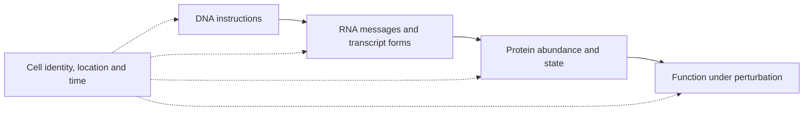

# Understand omics and multi-omics

**Learn what each molecular layer measures and how combining layers tests a claim without making every measurement independent.** This is the main entry point for multi-omics. The vocabulary course and assay lessons support this path.

## The big ideas

1. DNA, RNA and protein describe related but different biological quantities.
2. Cell identity, location, function and time are measurement axes, rather than extra interchangeable molecule lists.
3. Different preparations and samples can disagree without either assay being wrong.
4. Integration should answer a defined question, using compatible specimens and a stated evidence chain.

## The map

*The central dogma explains information flow; the dotted axes explain what each measurement samples.*

## What each layer can add

| Layer | Measurement | Tempting overread |
|---|---|---|
| Genomics | DNA sequence, copy number and rearrangements | A variant is expressed, functional or drug-sensitive |
| Transcriptomics | Captured RNA and transcript forms | High RNA guarantees surface protein or dependence |
| Proteomics | Protein abundance or measured modifications | Total protein establishes activation or location |
| Epigenomics | Features such as methylation or chromatin accessibility | Standard WGS (whole-genome sequencing) measures all regulatory states |
| Metabolomics | Small molecules involved in metabolism | Abundance establishes metabolic flux |

“Omics” means a broad molecular measurement, not that every molecule was measured. RNA made from DNA can be processed into different transcripts; translation and degradation affect protein. The instruction/message/machinery analogy organizes these layers but does not eliminate regulation between them.

## A question-first route

| Question | Continue to |
|---|---|
| Which cells supplied the signal? | [Tissue and cell vocabulary](/wiki/education/multi-omics-foundations/index) |
| What does a DNA result establish? | [DNA lesson](/wiki/education/molecular-profiling/01-dna-the-blueprint) |
| What do RNA counts and subtype calls mean? | [RNA lesson](/wiki/education/molecular-profiling/02-rna-the-activity-layer) |
| Is protein present, active and accessible? | [Protein lesson](/wiki/education/molecular-profiling/03-protein-expression-and-activation) |
| Where are the cells and signals? | [Spatial lesson](/wiki/education/molecular-profiling/04-spatial-biology) |
| What happens after perturbation? | [Functional testing](/wiki/education/molecular-profiling/05-functional-drug-response) |
| What changed in blood over time? | [ctDNA and MRD](/wiki/education/molecular-profiling/06-ctdna-and-mrd) |
| Does a finding support an action? | [Evidence and clinical gates](/wiki/education/molecular-profiling/07-from-data-to-care-plan) |

## A worked integration

A hypothetical splice-site DNA variant prompts RNA-junction analysis. Abnormal junctions strengthen a transcript-processing mechanism; protein consequence and current repair function still require other evidence. This is a targeted evidence chain. Counting three assays as three independent “votes” would ignore that they measure related parts of the same process.

A bulk target signal can also come from normal neighbors. A malignant-cell analysis asks who supplied it. Spatial protein staining asks where it is. A functional perturbation asks whether the model needs it. None automatically converts the target into an effective medicine.

## Why layers disagree

Cell mixture, preparation chemistry, time after treatment, spatial sampling, assay sensitivity and regulation between layers can all matter. First check those explanations; do not force agreement. Integration may align samples and features computationally, compare hypotheses across independent methods, or use a prespecified causal experiment. State which approach was used and what assumptions it adds.

## Try it

A gene has extra DNA copies but low measured protein. Is that impossible?

**Answer:** No. Expression, transcript processing, translation, degradation, sample mixture and assay limits can separate those quantities.

**Explain it back:** “I need the cells, molecular layer, specimen, comparison and evidence status before interpreting agreement.”

## Applied to Diana

[[wiki/care/molecular-profile|The molecular profile]] and [[wiki/omics/specimen-to-sample-map|the specimen map]] own case results and integration. [[wiki/education/reading-a-tumor/index|Read an individual report]] supplies the six-question checklist.

**Takeaway:** Combine layers to test a defined claim, rather than adding assay names as proof.

**Vocabulary:** ctDNA means circulating tumor DNA.

**Vocabulary:** MRD means molecular residual disease.

## Sources and scope

Source check: October 8, 2026; expert and learner review pending.

- [NHGRI central dogma](https://www.genome.gov/genetics-glossary/Central-Dogma).
- [[wiki/education/multi-omics-foundations/07-comparisons-and-evidence|Comparison and evidence methods]].

## Lessons

| Lesson | Question | Minutes |
|---|---|---|
| [Pathology](/wiki/education/guides/reading-pathology-and-surgery-results/index) | What did tissue examination establish? | 10 |
| [Evidence](/wiki/education/guides/reading-cancer-evidence/index) | What does a study justify? | 15 |

## Concepts you will use

- [[wiki/education/concepts/evidence-and-statistics/biomarkers/actionability|Clinical actionability]]
- [[wiki/education/concepts/breast-cancer/surgery-and-pathology-results/pcr|Pathologic complete response (pCR)]]
