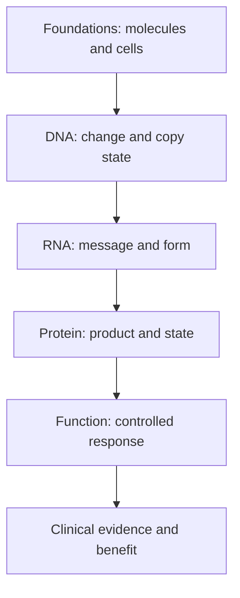

# Understand multi-omics, one question at a time

**Learn what each molecular layer measures, then combine compatible observations into a claim you can explain.** You do not need to memorize hundreds of genes. Start with the object measured and the question it can answer.

This is the canonical learning path. The foundations lessons build the vocabulary; the assay lessons put it to work. Plan two or three sittings, or use the question column to find the step you need.

## The big ideas

1. [[wiki/education/concepts/biology-basics/genetics/central-dogma|DNA, RNA and protein]] are related objects, not interchangeable evidence.
2. A tissue contains cancer cells and normal neighbors. [[wiki/education/concepts/cancer-biology/what-cancer-is/tumor-heterogeneity|Heterogeneity]] also means the sampled cancer cells can differ.
3. Preparation, location and time are part of every result.
4. [Multi-omic integration](/wiki/education/concepts/measurement/computational-analysis/multi-omic-integration) tests a defined claim; related reports are not automatically independent votes.
5. A persuasive mechanism and a clinically useful treatment require different evidence.

## The map

*The arrows name questions to investigate. A measured box does not guarantee the next one.* Check cell identity, location and sample time at every layer. Blood time series add repeated assay-specific snapshots; eligibility and benefit still need their own clinical evidence. Use the lesson table for each linked step.

## Lessons

| # | Lesson | Question it answers | Minutes | Learning aid |
|---|---|---|---|---|
| 1 | [Start with genes, RNA and protein](/wiki/education/multi-omics-foundations/00-genes-rna-and-protein) | What are genes, messages and products? | 8 | Recipe analogy |
| 2 | [See what is inside a tissue sample](/wiki/education/multi-omics-foundations/01-epithelial-and-breast-tissue) | Which normal neighbors share the sample? | 8 | Normal-comparator example |
| 3 | [Separate cell identity from cell state](/wiki/education/multi-omics-foundations/02-cell-identity-and-state) | Which label describes identity versus activity? | 8 | Identity/state table |
| 4 | [Read RNA counts without counting proteins](/wiki/education/multi-omics-foundations/03-reading-rna-counts) | What does a captured count mean? | 10 | Molecule and CPM exercise |
| 5 | [Separate DNA copies from cancer-cell fractions](/wiki/education/multi-omics-foundations/04-copies-alleles-and-clones) | How do copies change variant fractions? | 10 | Copy/variant fraction exercise |
| 6 | [Follow a splice change toward repair function](/wiki/education/multi-omics-foundations/05-splicing-and-dna-repair) | Does a message change impair repair now? | 10 | Repair-history comparison |
| 7 | [Separate immune presence from tumor recognition](/wiki/education/multi-omics-foundations/06-immune-presence-and-recognition) | Do immune cells recognize the tumor? | 10 | Recognition ladder |
| 8 | [Choose the comparison before interpreting the signal](/wiki/education/multi-omics-foundations/07-comparisons-and-evidence) | Compared with what, using which evidence? | 10 | Target-selectivity example |
| 9 | [Read a DNA assay as a coverage-and-confidence claim](/wiki/education/molecular-profiling/01-dna-the-blueprint) | Could the assay detect the proposed DNA change? | 10 | Assay card |
| 10 | [Use RNA to test the message and its source](/wiki/education/molecular-profiling/02-rna-the-activity-layer) | Was the relevant message made, and by whom? | 10 | Splice-product example |
| 11 | [Ask whether protein is present, placed and active](/wiki/education/molecular-profiling/03-protein-expression-and-activation) | Is protein present, placed and active? | 10 | Location-versus-abundance example |
| 12 | [Add the geography of cells and signals](/wiki/education/molecular-profiling/04-spatial-biology) | Where are the cells and signals? | 10 | Prediction-versus-measurement exercise |
| 13 | [Test a mechanism in a living model](/wiki/education/molecular-profiling/05-functional-drug-response) | What happens under a controlled perturbation? | 10 | Control checklist |
| 14 | [Read blood measurements as a time series](/wiki/education/molecular-profiling/06-ctdna-and-mrd) | What did this blood sample detect? | 10 | Detection-limit example |
| 15 | [Build an integrated claim without skipping the clinical question](/wiki/education/molecular-profiling/07-from-data-to-care-plan) | What claim does the combined evidence support? | 12 | Integrated repair ledger |

## Concepts you will use

**Foundations:** [[wiki/education/concepts/biology-basics/genetics/central-dogma|Central dogma]], [[wiki/education/concepts/biology-basics/genetics/mutation-types|mutation types]], [[wiki/education/concepts/biology-basics/genetics/germline-vs-somatic|germline versus somatic]] and [[wiki/education/concepts/cancer-biology/what-cancer-is/oncogene-and-tumor-suppressor|oncogenes versus tumor suppressors]].

**Measurements:** [[wiki/education/concepts/measurement/sequencing-basics/panel-exome-genome|Panel, exome and genome]], [[wiki/education/concepts/measurement/sequencing-basics/variant-allele-fraction-and-cancer-cell-fraction|variant allele fraction (VAF) versus cancer cell fraction (CCF)]], [[wiki/education/concepts/measurement/transcriptomics/bulk-rna-seq|bulk RNA sequencing]], [[wiki/education/concepts/measurement/pathology-readouts/immunohistochemistry|immunohistochemistry (IHC)]], [[wiki/education/concepts/measurement/pathology-readouts/stil-scoring|stromal tumor-infiltrating lymphocyte (TIL) scoring]] and [[about/Terminology#ctdna|circulating tumor DNA (ctDNA)]] [[wiki/education/concepts/measurement/liquid-biopsy/ctdna-units|units]].

**Reasoning:** [[wiki/education/concepts/evidence-and-statistics/biomarkers/prognostic-vs-predictive|Prognostic versus predictive evidence]] and [[wiki/education/concepts/evidence-and-statistics/biomarkers/actionability|clinical actionability]]. Concept pages supply the stable definitions; the lessons supply decisions and practice.

**Go deeper into assay confidence:** [sequencing reads](/wiki/education/concepts/measurement/sequencing-basics/sequencing-reads), [depth and coverage](/wiki/education/concepts/measurement/sequencing-basics/sequencing-depth-and-coverage), [tumor-normal comparison](/wiki/education/concepts/measurement/sequencing-basics/tumor-normal-vs-tumor-only-sequencing), [variant calling](/wiki/education/concepts/measurement/sequencing-basics/variant-calling), [RNA integrity](/wiki/education/concepts/measurement/specimens/rna-integrity) and [batch effects](/wiki/education/concepts/measurement/transcriptomics/batch-effects). For protein questions, compare [mass-spectrometry proteomics](/wiki/education/concepts/measurement/proteins-and-spatial/mass-spectrometry-proteomics) with [phosphoproteomics](/wiki/education/concepts/measurement/proteins-and-spatial/phosphoproteomics). For spatial questions, pair [multiplex immunofluorescence](/wiki/education/concepts/measurement/proteins-and-spatial/multiplex-immunofluorescence) or [imaging mass cytometry](/wiki/education/concepts/measurement/proteins-and-spatial/imaging-mass-cytometry) with [cell segmentation](/wiki/education/concepts/measurement/proteins-and-spatial/cell-segmentation). The result's meaning depends on its measurement method.

**Choose a specialist question:** [cell versus nucleus RNA](/wiki/education/concepts/measurement/transcriptomics/single-cell-and-single-nucleus-rna-seq), [fusion or splice evidence](/wiki/education/concepts/measurement/transcriptomics/fusion-and-splice-detection), [gene-expression signatures](/wiki/education/concepts/measurement/transcriptomics/gene-expression-signatures), [targeted protein quantification](/wiki/education/concepts/measurement/proteins-and-spatial/targeted-proteomics-and-loq), [reverse-phase protein array (RPPA)](/wiki/education/concepts/measurement/proteins-and-spatial/rppa) and [spatial RNA](/wiki/education/concepts/measurement/proteins-and-spatial/spatial-transcriptomics). The DNA and blood lessons introduce their additional readouts at the point of use.

## Follow one fictional repair finding

Imagine a supported splice-site DNA change in repair gene R. RNA analysis finds an abnormal message. Tissue staining finds reduced R signal in malignant cells, while the amount of intact product remains an assay-specific question. A suitable controlled model then shows impaired repair. Each finding strengthens a specific bridge in the story.

They do not yet establish a drug's clinical benefit. The [[wiki/education/molecular-profiling/07-from-data-to-care-plan|final lesson's integrated ledger]] traces the full chain, including sample attribution, drug perturbation and the remaining clinical gate. The [[wiki/education/reading-a-tumor/index|report-reading checklist]] helps translate each real report into the same structure.

## Choose a shorter route

New to the words? Read steps 1–5 before jumping to an assay. Reading a splice finding? Follow steps 6, 9, 10, 11 and 15. Evaluating a surface target? Follow steps 2, 8, 10, 11 and 15. Reading a blood result? Use step 14 and the [[wiki/education/concepts/measurement/liquid-biopsy/ctdna-units|units reference]].

These shortcuts save time while keeping the prerequisites available. They are learning routes, rather than testing recommendations.

## Applied to Diana

[[wiki/care/molecular-profile|The molecular profile]] owns case interpretation. [[wiki/omics/specimen-to-sample-map|The specimen map]] preserves attribution across samples, and [[wiki/questions/index|the decision pages]] own clinical questions. Use those current owners when applying the general teaching here.

## What is still uncertain

No one measurement captures every region, cell or timepoint. Cell assignment, sample compatibility, model fidelity and clinical utility may remain unresolved even when some layers agree. Integration should state those gaps rather than hide them behind the number of assays.

## Sources and scope

Source check: October 9, 2026. Individual lessons cite the relevant methods and primary studies. Expert and learner review remain pending.

- [NHGRI central dogma](https://www.genome.gov/genetics-glossary/Central-Dogma).
- [NCI biomarker testing](https://www.cancer.gov/about-cancer/treatment/types/biomarker-testing-cancer-treatment).
