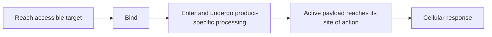

# Follow delivery, exposure, and the treatment clock

**A dose starts an exposure history. Binding, transport, payload processing, immune activation, and injury can happen on different clocks.**

It is tempting to picture an infusion as an on switch and the end of the infusion as an off switch. A more useful picture is a sequence of events. Some molecules leave the blood, some remain attached to cells, and some effects continue after the initiating exposure changes. Track the event that was measured before naming the effect.

**Before you start:** [Antibody-drug conjugates (ADCs)](/wiki/education/concepts/therapeutics/antibody-based/antibody-drug-conjugate) separate binding, processing, and payload action. [T-cell engagers](/wiki/education/concepts/therapeutics/antibody-based/t-cell-engager) require productive immune contact. [Chemotherapy](/wiki/education/concepts/therapeutics/chemotherapy/chemotherapy) explains why chemical exposure can affect susceptible cancer and normal cells.

## Where this step sits

This is step 2 of [Aiming a drug at a surface target](/wiki/education/guides/aiming-a-drug-at-a-surface-target/index): recognition and action → **delivery and exposure** → safety and clinical evidence.

## Follow the product through the cell

For a familiar ADC route, the product reaches a cell, binds its target, enters the cell, and is processed. An active payload or breakdown product must then reach a susceptible process. The route is product-specific; a diagram should never turn these stages into universal guarantees.

A useful experiment assigns a measurement to each part of the chain:

| Question | A possible measurement | What that result does not establish |
|---|---|---|
| Does it bind? | Product binding on viable target-positive and control cells | Delivery throughout a tumor |
| Does material enter the cell? | A validated trafficking assay that distinguishes internal from surface signal | Formation of active payload |
| Is active material formed and delivered? | Assay for the relevant payload or active breakdown product, with compartment information when needed | Sufficient damage or cell death |
| Is the intended process affected? | A mechanism-appropriate functional readout | A useful clinical outcome |
| Do cells survive? | Time-dependent survival measurements with controls | Safe exposure or benefit in a person |

The word **validated** matters. An assay must distinguish the quantities the claim depends on. A fluorescent antibody label follows antibody-associated signal; it cannot automatically reveal whether the active chemical is still attached, has been released, or has reached the cytoplasm.

Primary transport experiments offer a concrete example. For trastuzumab emtansine, SLC46A3 can transport an active lysosomal breakdown product. Binding and uptake can therefore leave an important later step unanswered. This finding explains a specific studied mechanism; it does not establish that all ADCs need the same transporter.

## Worked example: two models, one binding result

In fictional Models A and B, the same ADC binds accessible target M. A trafficking assay shows internalized material in both. A chemical assay detects the relevant active breakdown product reaching its action compartment in A, with substantially less in B. Later, survival falls in A but changes little in B.

You can now say the models differ after uptake under these conditions. You cannot yet say the linker is the cause. The difference could involve processing, transport, or another measured or unmeasured factor.

A useful next comparison tests the active payload independently with verified exposure to its action compartment. If B is sensitive under those conditions, a delivery or processing bottleneck becomes more plausible. If B remains insensitive, payload response needs further investigation. Neither result alone identifies a treatment for people.

Notice how the conclusion grows with each assay. “Binds M,” “enters cells,” “produces active material,” and “reduces survival” are increasingly informative observations. Keeping them separate makes a disagreement easier to investigate.

## Exposure is more than the amount infused

**Dose** is the amount administered. **Exposure** concerns concentration and time in a named place. [**Pharmacokinetics**](/wiki/education/concepts/therapeutics/how-drugs-work/pharmacokinetics-and-half-life) describes how the body handles the product; **pharmacodynamics** concerns its biological effects. These are related but distinct questions.

An ADC can generate several measurable species. The antibody carrying payload, the total antibody signal, and unconjugated payload need not follow identical time courses. A long-lasting antibody signal cannot, by itself, show sustained exposure to active payload at the tumor. The FDA's ADC guidance recommends product-appropriate measurements of the conjugate and its constituent parts to interpret benefit and harm.

For an engager, declining protein exposure can reduce continued engagement, but inflammation or tissue injury may continue. For receptor-engineered cells, the relevant product is living cells that can expand, decline, or persist. A [chimeric antigen receptor (CAR)](/wiki/education/concepts/therapeutics/cell-therapies/car-anatomy) on a T cell is not cleared like a freely circulating protein. Cell persistence itself does not prove continued tumor control.

Radiopharmaceuticals add another clock: radioactive decay alongside biological distribution and clearance. **Dosimetry** estimates absorbed radiation dose in tissues. Seeing a tracer accumulate is not the same as establishing the therapeutic dose, its distribution, or its safety.

## Keep three practical clocks separate

A proposed “six-month timeline” is incomplete until you know what it describes.

| Clock | What starts and ends it? | The question to ask |
|---|---|---|
| Product development | Candidate design through testing and development | Is there a clinically usable product at all? |
| Manufacturing and release | Making a specified batch through required quality release | Is the actual treatment material ready? |
| Dosing and biological effects | Administration through exposure and subsequent effects | What schedule and monitoring have supporting evidence? |

A new laboratory binder may never become a treatment. Manufacturing a known product is a different task from developing one. Repeated protein dosing, personalized cell production, and the duration of a biological effect also require separate descriptions. A modality name supplies no universal duration.

## What can go wrong at this step

**One signal can stand in for several quantities.** Check whether the assay detects total antibody, conjugated product, free payload, or an active breakdown product.

**An endpoint can hide the sequence.** A single late survival measurement cannot identify which earlier stage caused a difference. Use matched controls and time points that answer the proposed mechanism.

**Stopping dosing can be mistaken for reversing harm.** A phase 1 surface-target engager study documented serious toxicity that did not always resolve simply with discontinuation. Safety controls require product-specific evidence.

**Manufacturing speed can be mistaken for availability.** Readiness, clinical authorization, eligibility, and an available treatment site remain distinct gates. [The access guide](/wiki/education/guides/accessing-experimental-therapy/index) develops those practical questions.

## Try it

A fictional report says: “Antibody is still detectable two weeks after infusion, so active payload must still be working in every tumor cell.” Which two measurements would most directly address the missing links?

**Possible answer:** measure the relevant active payload or breakdown product with a validated assay, and assess a mechanism-appropriate effect in the relevant tumor setting. Total antibody persistence answers neither by itself. Sampling and spatial coverage still limit what either measurement can establish.

## Explain it back

Complete: “The dose tells me ______; the exposure measurement tells me ______; the effect assay tells me ______.”

**One possible answer:** the dose tells me what was administered. Exposure tells me how much of a named species was present, where, and over time. The effect assay tells me what happened biologically under its conditions.

## Takeaway

**Follow a named product and a named effect through time; do not let binding, dose, or persistence stand in for the whole delivery chain.**

**Next:** [Compare formats with evidence and normal-tissue risk](/wiki/education/targeted-therapy-modalities/06-comparisons).

## Sources and scope

Source check: October 9, 2026. General delivery and timing concepts with fictional examples; expert and learner review remain pending. No treatment duration, dose, or access promise is supplied here.

- [FDA, 2024: ADC clinical pharmacology](https://www.fda.gov/media/155997/download) — measurement of conjugate, constituent parts, and exposure–response.
- [Tomabechi and colleagues, 2022: active payload-product transport](https://pubmed.ncbi.nlm.nih.gov/36741448/) — a specific intracellular delivery step.
- [Primary phase 1 solitomab study, 2018](https://pubmed.ncbi.nlm.nih.gov/30221040/) — exposure and clinical toxicity limits for one engager.
- [NCI: CAR T cells](https://www.cancer.gov/about-cancer/treatment/research/car-t-cells) — manufacture and potential expansion of living cells.
- [FDA, 2019: therapeutic radiopharmaceutical development](https://www.fda.gov/media/129547/download) — biodistribution, radiation dose, and safety assessment.
