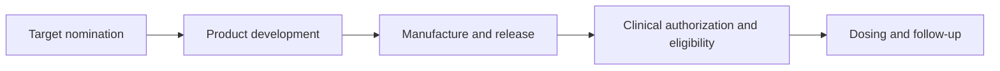

# Timing: development, readiness and dosing

**You will be able to:** Separate a development estimate, a released product and a clinical treatment schedule.

“How long does it take?” has at least three answers: time to discover and develop a product, time to make and release a particular batch, and the patient's dosing and follow-up schedule. A date for one stage is not a date for the others.

**Before starting:** [Mechanism](/wiki/education/targeted-therapy-modalities/01-mechanism).

## Read the timeline by stage

*The chart shows dependencies, not a promised duration.*

| Stage | What must be known | Why a forecast can change |
|---|---|---|
| Target nomination | Relevant target and intended setting | Sampling, expression and specificity may invalidate a candidate |
| Development | A usable binder, format and evidence plan | Affinity, normal-tissue binding, stability or activity may require redesign |
| Manufacture and release | Controlled process and product-specific quality criteria | Batch failure, contamination, potency or comparability problems |
| Clinical readiness | Protocol or access pathway, site capability and eligibility | Organ function, toxicity, disease state and available alternatives |
| Dosing | Route, dose, cadence, monitoring and stopping rules | Toxicity, response, progression and protocol requirements |

## An established process differs from a new therapy

Manufacturing an established autologous CAR (chimeric antigen receptor)-T product can take weeks. Developing a new receptor and manufacturing process can take much longer and may never yield a clinically usable product. A quoted timeline from one platform cannot be assigned to every cellular or antibody therapy.

Likewise, developing a binder in parallel with a vaccine may save research time, but it does not establish that either treatment should be given. A binder stored as a research reagent is not automatically a released clinical drug with a validated shelf life.

## Access time is a separate clock

For a **new non-emergency individual-patient expanded-access IND**, FDA's default is 30 days after receipt or earlier FDA notification. Emergency use may begin after FDA authorization before a written submission. A protocol under an existing IND has a different process. These rules are not universal three-month development estimates and do not remove manufacturer, institutional or ethics requirements.

## Try it

A proposal gives “six months to manufacture” and “monthly dosing.” What is still missing?

**Explain it back:** Which product is being made, when development is complete, what release and clinical gates apply, route and duration of dosing, monitoring, and which events stop or delay treatment.

## Explain it back

Use conditional milestones until the product, process and clinical plan are confirmed. An illustrative calendar is not a treatment schedule.

## Takeaway

**Use conditional milestones until the product, process and clinical plan are confirmed. An illustrative calendar is not a treatment schedule.**

## Current application

Treatment status belongs in [the care plan](/wiki/care/treatment-plan), unresolved choices in [questions](/wiki/questions/index), and provider-specific capabilities in [companies](/wiki/companies/index). A mechanism lesson does not establish eligibility or a treatment plan.

## Sources

Checked October 8, 2026.

- [NCI: CAR-T manufacture](https://www.cancer.gov/about-cancer/treatment/research/car-t-cells).
- [FDA: expanded-access categories](https://www.fda.gov/news-events/expanded-access/expanded-access-categories-drugs-including-biologics).
- [FDA: clinical-treatment IND overview](https://www.fda.gov/drugs/investigational-new-drug-application-ind/ind-applications-clinical-treatment-expanded-access-overview).
