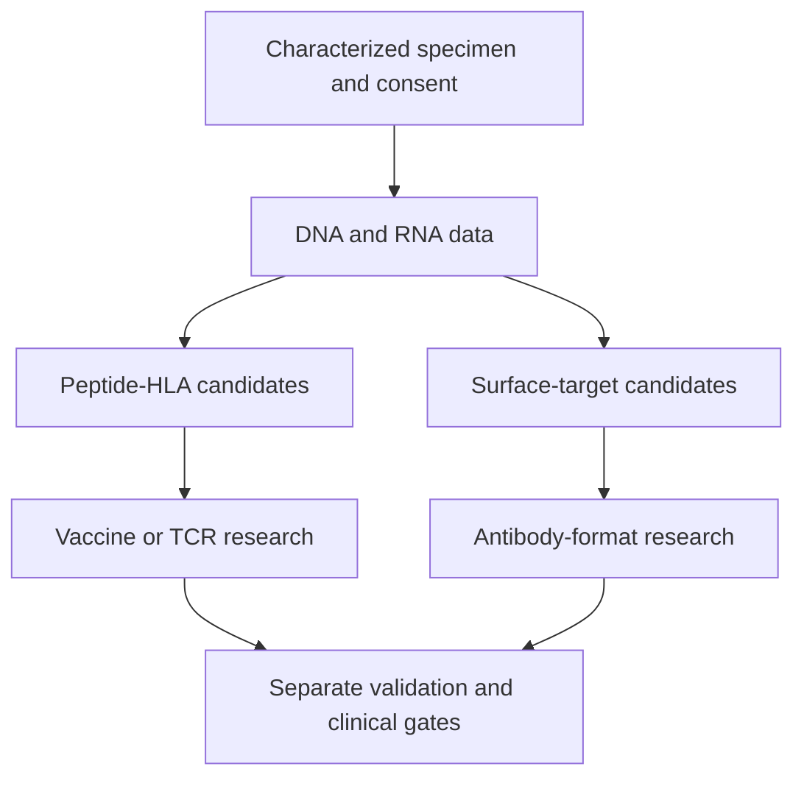

# Overlap and sequencing

**You will be able to:** Distinguish parallel laboratory development from evidence for combining treatments in a person.

Two research activities can run simultaneously without making their resulting treatments safe or useful to give together. Development dependencies and clinical sequencing answer different questions.

**Before starting:** [Timing](/wiki/education/targeted-therapy-modalities/02-timing) and [prognostic versus predictive evidence](/wiki/education/concepts/evidence-and-statistics/biomarkers/prognostic-vs-predictive).

## Shared data, different experiments

*Data can be reused. Physical specimens, validation and clinical authorization cannot be assumed interchangeable.*

RNA sequencing can inform both surface-target and peptide-target research. TCR (T-cell receptor) sequencing identifies receptor sequences and clonotypes; it does not by itself establish antigen specificity or tumor killing. A surface target also needs protein localization, accessibility and normal-tissue evaluation.

## Which dependencies are real?

| Dependency | Reason |
|---|---|
| Relevant target before target-specific testing | The experiment needs a defined question |
| A real product before product-specific potency and safety testing | A theoretical binder is not the tested therapy |
| Defined process before clinical batch release | Clinical use needs consistent identity, quality and potency |
| Clinical assessment before administration | A laboratory result does not supply eligibility or a safe regimen |

Some process development and documentation can overlap. The exact order depends on the platform. A simple diagram should not imply that all safety work finishes before any manufacturing development starts.

## Clinical overlap requires a new comparison

Combining modalities can add overlapping toxicity, change immune-cell numbers or make adverse effects harder to attribute. A shared target or different killing mechanism is a rationale to study a combination, not evidence of added benefit.

Prior checkpoint exposure does not establish a safe checkpoint partner for a later therapy. Previous immune-related pneumonitis is clinically relevant. A negative ctDNA (circulating tumor DNA) result or high residual cancer burden does not settle the safety or benefit of an investigational combination.

## Collection timing is product-specific

There is no universal rule that leukapheresis must occur before a vaccine. Timing may matter for a research baseline, cell quality or a specific manufacturing protocol. Engineered T-cell manufacture can use peripheral cells; native TIL (tumor-infiltrating lymphocyte) therapy relies on tumor-derived lymphocytes. Consult the actual requirements rather than imposing one ordering on both.

## Try it

A sample supports both antibody discovery and vaccine design. Can the therapies be given concurrently?

**Explain it back:** The common data input establishes neither combination efficacy nor safety. Each product needs validation and the clinical combination needs an evidence and monitoring plan.

## Explain it back

Parallelize suitable work only after identifying its dependencies. Assess treatment overlap as a separate clinical question.

## Takeaway

**Parallelize suitable work only after identifying its dependencies. Assess treatment overlap as a separate clinical question.**

## Current application

Treatment status belongs in [the care plan](/wiki/care/treatment-plan), unresolved choices in [questions](/wiki/questions/index), and provider-specific capabilities in [companies](/wiki/companies/index). A mechanism lesson does not establish eligibility or a treatment plan.

**Vocabulary:** HLA means human leukocyte antigen.

## Sources

Checked October 8, 2026.

- [NCI: T-cell transfer therapy](https://www.cancer.gov/about-cancer/treatment/types/immunotherapy/t-cell-transfer-therapy).
- [FDA: individual-patient expanded access](https://www.fda.gov/drugs/investigational-new-drug-application-ind/physicians-how-request-single-patient-expanded-access-compassionate-use).
- [TCR recognition and sequencing](/wiki/education/molecular-profiling/tcr-and-tcr-sequencing) — sources and distinction between sequence and function.
