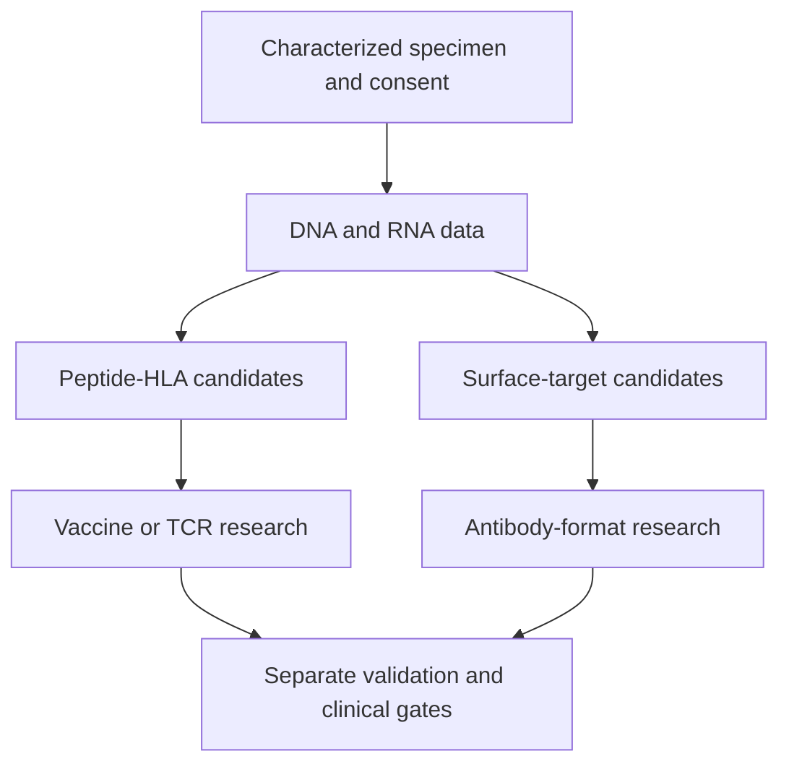

# Overlap and sequencing

**Parallel research can share information, but each experiment still needs its own inputs, and treatment overlap needs separate clinical evidence.**

**Before you start:** [Human leukocyte antigen (HLA)](/wiki/education/concepts/immunology/antigen-presentation/hla) displays protein fragments. [T-cell receptor (TCR)](/wiki/education/concepts/immunology/t-cells/t-cell-receptor) recognition differs from [sequencing](/wiki/education/concepts/measurement/immune-monitoring/tcr-sequencing), which identifies sampled receptors. [Finite tissue](/wiki/education/concepts/measurement/specimens/tissue-is-non-renewable) makes destructive testing a tradeoff. [Prognostic versus predictive evidence](/wiki/education/concepts/evidence-and-statistics/biomarkers/prognostic-vs-predictive) separates outcome associations from treatment-effect claims.

## Where this step sits

After [following delivery and the treatment clock](/wiki/education/targeted-therapy-modalities/02-timing), this supporting lesson in [aiming a drug at a surface target](/wiki/education/guides/aiming-a-drug-at-a-surface-target/index) asks which activities can overlap. Read a research plan before assessing a treatment proposal.

## Shared data, different experiments

Think of two teams using copies of the same blueprint. They can work at the same time. That does not prove their finished products work well together. The analogy has a limit: a tissue specimen is physical and finite, even when its data can be copied.

[Deoxyribonucleic acid (DNA)](/wiki/education/concepts/biology-basics/molecules/dna) and [ribonucleic acid (RNA)](/wiki/education/concepts/biology-basics/molecules/rna-and-mrna) data can inform different target searches:

*Data can be reused. Physical specimens, validation and clinical authorization cannot be assumed interchangeable.*

RNA sequencing can inform both surface-target and peptide-target research. It does not prove that a surface protein is present or accessible. [TCR sequencing](/wiki/education/concepts/measurement/immune-monitoring/tcr-sequencing) identifies receptor sequences and clonotypes; it does not by itself establish antigen specificity or tumor killing. A surface target also needs protein localization, accessibility and normal-tissue evaluation. The [receptor-and-sequencing lesson](/wiki/education/molecular-profiling/tcr-and-tcr-sequencing) follows the gap between sequence and function.

## Which dependencies are real?

A **hard dependency** is something the named step needs before it can happen: an input, a permission or a required check. A **soft preference** is an order someone would like, but the step can proceed without it under the stated constraints. Ask “What fails if we change the order?” before treating a preference as a requirement.

| Dependency | Reason |
|---|---|
| Relevant target before target-specific testing | The experiment needs a defined question |
| A real product before product-specific potency and safety testing | A theoretical binder is not the tested therapy |
| Defined process before [clinical batch release](/wiki/education/concepts/engineering-and-manufacturing/cmc-and-quality/batch-release) | Clinical use needs consistent identity, quality and potency |
| Clinical assessment before administration | A laboratory result does not supply eligibility or a safe regimen |

Batch release concerns a particular lot's quality. It does not establish clinical suitability. Some process development and documentation can overlap. The exact order depends on the platform. A simple diagram should not imply that all safety work finishes before any manufacturing development starts.

**Reversibility is a separate question:** Can the team change course without losing material or closing an option? Reordering a meeting is different from consuming tissue. A hard requirement can govern a reversible action, and a preferred action can still consume material.

## Worked worksheet: two fictional laboratories

Imagine a research team with an archived **[formalin-fixed, paraffin-embedded (FFPE) block](/wiki/education/concepts/measurement/specimens/ffpe-vs-fresh-frozen-vs-viable)** and existing DNA/RNA data. These are invented constraints for this exercise, not laboratory instructions:

- **Lab A** accepts the existing dataset and its quality report for candidate ranking. Data reuse is permitted. It needs no new sections and does not need Lab B's result to start.
- **Lab B** has confirmed that the block preparation and selected region fit its protein-localization study. It requires four sections. The custodian has identified six research sections after protecting diagnostic needs, but release to Lab B is still unconfirmed.
- The coordinator would prefer one meeting after both reports arrive. Neither lab requires that meeting before starting.
- No treatment product, combination study or clinical administration plan is supplied.

Complete the worksheet before revealing the answer. Name what must come first, whether it is a hard requirement or a preference, and what remains reversible.

| Proposed action | What must come first? | Hard requirement or preference? | What can be undone? |
|---|---|---|---|
| Start Lab A's analysis | ___ | ___ | ___ |
| Cut and use four sections for Lab B | ___ | ___ | ___ |
| Wait for both reports before any analysis | ___ | ___ | ___ |
| Give resulting treatments together | ___ | ___ | ___ |

Show a worked answer

| Proposed action | Dependency and classification | Reversibility |
|---|---|---|
| Start Lab A | Accepted data, quality report and permitted use are hard requirements; supplied here. Waiting for Lab B is unnecessary under this lab's stated rules. | A new analysis can be revised without consuming new tissue. Preserve the original data. |
| Cut and use four sections | Custodian release is an unresolved hard gate. The lab's input requirements and diagnostic reserve also need to remain satisfied. | Consumed material cannot be restored by returning the block. Confirm release and record use before committing material. |
| Wait for both reports | A scheduling preference, not an experimental prerequisite in this scenario. | Rebook the meeting; this uses no tissue. |
| Give treatments together | Clinical combination evidence, an exact regimen and applicable readiness gates are missing. These are separate from the lab schedule. | Administration is not equivalent to a reversible planning inquiry; changing a plan cannot undo an administered dose. |

Lab A can start while the team asks the custodian about Lab B's release. That inquiry consumes no tissue. Four of six sections would leave two under the exercise's assumptions; this arithmetic does not predict assay success, yield or future adequacy. The fixed block does not imply a viable-cell input.

What remains unknown? Whether release will be permitted, whether the study succeeds, and whether any resulting product helps a person. Keep those questions visible rather than turning a feasible research schedule into a treatment promise.

## Clinical overlap requires a new comparison

Combining modalities can add overlapping toxicity, change immune-cell numbers or make adverse effects harder to attribute. A shared target or different killing mechanism is a rationale to study a combination, not evidence of added benefit.

Prior [immune checkpoint inhibitor](/wiki/education/concepts/therapeutics/immunotherapy/immune-checkpoint-inhibitor) exposure does not establish a safe checkpoint partner for a later therapy. Previous immune-related pneumonitis—lung inflammation—is clinically relevant. A negative [circulating tumor DNA (ctDNA)](/wiki/education/concepts/measurement/liquid-biopsy/cfdna-vs-ctdna) result or high [residual cancer burden](/wiki/education/concepts/breast-cancer/surgery-and-pathology-results/residual-cancer-burden) does not settle the safety or benefit of an investigational combination.

Use the canonical [decision ledger](/wiki/education/guides/judging-a-test-or-vendor-claim/03-connect-evidence-to-a-decision) to name what evidence would change an action. The [readiness lesson](/wiki/education/guides/accessing-experimental-therapy/03-build-the-readiness-picture) separates permission, supply and clinical delivery. Neither ledger supplies an individual treatment recommendation.

## Collection timing is product-specific

There is no universal rule that [leukapheresis](/wiki/education/concepts/engineering-and-manufacturing/cell-manufacturing/leukapheresis) must occur before a vaccine. Timing may matter for a research baseline, cell quality or a specific manufacturing protocol. Engineered T-cell manufacture can use peripheral cells; native [tumor-infiltrating lymphocyte (TIL) therapy](/wiki/education/concepts/therapeutics/cell-therapies/til-therapy) relies on tumor-derived lymphocytes. Consult the actual requirements rather than imposing one ordering on both.

## What can go wrong at this step

- **A preference becomes a gate.** Ask which written requirement makes the order necessary.
- **Data reuse becomes specimen reuse.** Reanalysis does not return consumed tissue.
- **Input acceptance becomes a successful result.** An accepted specimen can still produce an uninformative study.
- **Parallel research becomes concurrent treatment.** Product and combination evidence remain separate questions.

## Try it

A sample supports both antibody discovery and vaccine design. Can the therapies be given concurrently?

Show the answer

The common data input establishes neither combination efficacy nor safety. Each product needs validation and the clinical combination needs an evidence and monitoring plan.

## Explain it back

Complete: “We can start ___ because its hard requirements are met. We should check ___ before consuming tissue. Waiting for ___ is a preference here. None of this shows ___.”

**One possible answer:** “Lab A's analysis; custodian release and the agreed specimen requirements; the combined meeting; that resulting treatments are safe or beneficial together.”

## Takeaway

**Parallelize suitable work only after identifying its dependencies. Assess treatment overlap as a separate clinical question.**

**Next:** [Questions for a targeted-therapy proposal](/wiki/education/targeted-therapy-modalities/04-decision-questions).

## Sources and scope

Source check: October 11, 2026. General research planning and evidence boundaries; all laboratory requirements and section counts in the worksheet are fictional. They provide no operating protocol, clinical sequencing rule, predicted yield or access guarantee. Expert and learner review remain pending.

- [NCI: T-cell transfer therapy](https://www.cancer.gov/about-cancer/treatment/types/immunotherapy/t-cell-transfer-therapy) — blood-derived engineered cells versus tumor-derived lymphocytes and treatment-related immune-cell reduction.
- [FDA: Investigational New Drug application](https://www.fda.gov/drugs/types-applications/investigational-new-drug-application-ind) — distinct manufacturing information and clinical protocol requirements; a U.S. overview, not a product-specific release specification.
- [FDA: individual-patient expanded access](https://www.fda.gov/drugs/investigational-new-drug-application-ind/physicians-how-request-single-patient-expanded-access-compassionate-use) — supplier, review and consent gates; no individual eligibility or availability decision.
- [Kula et al., 2019: T-Scan antigen discovery](https://pubmed.ncbi.nlm.nih.gov/31398327/) — primary functional target-discovery experiments; receptor sequence is a starting point for testing, not proof of tumor killing or benefit.
- [NCI: technical and operational biospecimen practices](https://dctd.cancer.gov/data-tools-biospecimens/biospecimens-biobanks/resources/best-practices/biospecimen-resources/technical-operational) — handling, quality and inventory principles; overview read, not a recertification of the full linked guidance or either fictional lab's requirements.
- [FDA: pembrolizumab prescribing information, July 2026, section 5.1](https://www.accessdata.fda.gov/drugsatfda_docs/label/2026/125514s194lbl.pdf) — immune-mediated pneumonitis and toxicity considerations; one checkpoint drug's label does not validate a new combination.
