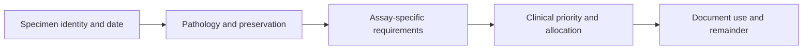

# Match a specimen to the test before spending tissue

**A useful allocation matches the test to the actual material, protects diagnostic needs, and records what remains. A stored dataset can be reused; an extraction cannot put tissue back.**

**Before you start:** [Fixed, fresh-frozen and viable tissue](/wiki/education/concepts/measurement/specimens/ffpe-vs-fresh-frozen-vs-viable) explains which properties each preparation preserves. [Tissue is non-renewable](/wiki/education/concepts/measurement/specimens/tissue-is-non-renewable) explains why sections and extractions spend a finite archive. [Single-cell and single-nucleus ribonucleic acid (RNA) sequencing](/wiki/education/concepts/measurement/transcriptomics/single-cell-and-single-nucleus-rna-seq) explains why captured profiles depend on preparation.

## Where this step sits

After naming a question about a targeted therapy, check whether the proposed measurement can use the available specimen. A suitable sample can support a test; it does not establish treatment benefit.

## The intuition: match the job to what is in the cupboard

Imagine planning a meal from a cupboard inventory. “One container left” does not tell you what is inside, whether it fits the recipe, or whether someone has reserved it. A specimen ledger has the same job: connect each request to the material actually available. The analogy stops at replenishment: a new collection cannot recreate the old specimen's exact place and time.

## Preparation limits the request

Use the preparation concept above for the definitions. [DNA (deoxyribonucleic acid)](/wiki/education/concepts/biology-basics/molecules/dna) is one molecule these tests can measure. Here, ask the allocation question:

| Material | What to confirm before assigning it |
|---|---|
| [Formalin-fixed, paraffin-embedded (FFPE) tissue](/wiki/education/concepts/measurement/specimens/ffpe-vs-fresh-frozen-vs-viable) | Does the named assay accept fixed tissue, and is the relevant region still present? It cannot supply the original living cells. |
| Snap-frozen tissue | Does the method accept this freezing and handling history? Molecular preservation does not establish viable-cell recovery. |
| Viably cryopreserved material | Are the recovery protocol, relevant living cells and method suitability confirmed? |
| Fresh tissue | Can the receiving laboratory meet its stated processing and transport requirements? |
| Blood or [leukapheresis material](/wiki/education/concepts/engineering-and-manufacturing/cell-manufacturing/leukapheresis) | Does the specific immune-cell or comparison workflow accept it? It does not replace a tumor specimen. |
| Plasma | Does the [cell-free DNA (cfDNA) or circulating tumor DNA (ctDNA)](/wiki/education/concepts/measurement/liquid-biopsy/cfdna-vs-ctdna) assay accept its collection, handling and timepoint? |

[Single-cell and single-nucleus RNA sequencing](/wiki/education/concepts/measurement/transcriptomics/single-cell-and-single-nucleus-rna-seq) methods also need different preparation plans. Some frozen tissues can supply nuclei without supplying recoverable living cells. Protocols and the cell populations captured can differ; neither label guarantees a useful dataset. [Slyper et al., 2020](https://www.broadinstitute.org/publications/broad630206).

A large tumor bed may include scar, normal tissue and immune cells. Quantity alone does not identify the cells needed for the question. Confirm the represented region and assay suitability with pathology and the receiving laboratory.

## Keep a specimen ledger

*Record the physical material and its custody separately from the data produced.*

**Custody** means who holds a portion and what happened at each handoff. Record its site, collection time, treatment context, preparation, represented cells, prior use, remaining quantity, location and permitted use. Research allocation needs pathology coordination and applicable permission. Diagnostic needs come first. The [National Cancer Institute (NCI) best practices](https://dctd.cancer.gov/data-tools-biospecimens/biospecimens-biobanks/resources/best-practices/biospecimen-resources/appendices/2026-4th-edition-best-practices.pdf) describe these planning and traceability principles.

## Worked example: complete the decision, including the unknowns

**Everything in this scenario is fictional. The laboratory requirements and permissions are supplied assumptions, not standard section counts or clinical instructions.**

A research coordinator receives three requests for one archived block. The current ledger is filled as follows:

| Ledger field | Recorded entry |
|---|---|
| Identity and collection | Teaching block A; sampled breast lesion, collection day 0, after systemic treatment |
| Preparation and content | FFPE; last pathology review identified a mixed region containing tumor, scar and immune cells |
| Quantity and prior use | One block remains; diagnostic sections were previously cut. Usable depth and relevant tissue remaining are **unknown** |
| Custodian and diagnostic needs | Pathology archive holds the block. Pathology must confirm its retained diagnostic reserve before research cuts |
| Permitted use | The exercise's authorization covers the named molecular and image projects; no physical transfer is yet approved |
| Data already available | Teaching image version 1; linked to the slide from the last reviewed level |

The request ledger records both requirements and the resulting decision:

| Request and supplied requirement | Material or data cost | Completed allocation decision |
|---|---|---|
| Lab A: DNA assay accepts FFPE; requests four sections, each 5 micrometres thick from a pathology-selected region | New cutting and extraction consume tissue; suitability still needs review | **Hold.** Ask pathology what relevant material remains after its reserve, and ask Lab A to confirm the selected input before any cuts |
| Lab B: growth experiment requires recoverable living tumor cells; does not accept fixed tissue | The available block is incompatible | **Reject this block for this request.** Ask what suitable input would be needed; this decision does not authorize another collection |
| Image team: accepts the existing slide image for a regional cell-count analysis under the supplied permission | No new section or extraction for this reuse | **Use the existing image.** Record the file version, original slide and permission; keep the physical block in the archive |

The plan is complete even though Lab A is on hold: the missing fact, responsible owner and next question are explicit. Do not turn “one block” into a guessed number of available sections or reserve a universal percentage.

For the approved image reuse, the existing [denominator exercise](/wiki/education/local-treatment-modalities/05-tissue-and-sample-budget#worked-example-the-percentage-rose-but-what-changed) supplies a useful check. Its two equal-sized areas contain 10 immune cells among 50 total cells, then 10 among 20. The fraction rises from 20% to 50% with no increase in the immune-cell count. Reusing that exercise keeps the interpretation task separate from whether a sample can be allocated.

## What can go wrong at this step

- Treating “frozen” as proof of living-cell recovery, or fixed tissue as interchangeable with fresh tissue.
- Spending sections before checking the diagnostic reserve and current represented region.
- Confusing permission to analyze data with permission to transfer or consume the block.
- Recording “block returned” without updating what was cut, extracted or retained elsewhere.

For any later authorized physical use, record the portion, sender, recipient, handling history, receipt, consumption and remainder. Returning a block does not restore consumed tissue. This lesson supplies no shipping protocol or prediction of future surgical yield.

## Try it

One laboratory asks for DNA and another for living cells. Can a paraffin block serve both? Which decision in the fictional ledger changes if pathology confirms enough suitable material for Lab A?

Reveal one answer

The block may support a DNA assay validated for that input, but it cannot provide the original living cells for Lab B. If pathology confirms the diagnostic reserve and suitable remainder, Lab A can proceed only after its input and the required permissions are confirmed. Update cuts, custody and remainder when use occurs; Lab B's incompatibility remains.

## Explain it back

Fill in: “I would hold ___ because ___, reject ___ because ___, and reuse ___ while recording ___.”

**One possible answer:** “I would hold the extraction because suitable remaining tissue is unknown, reject the living-cell request because the block is fixed, and reuse the permitted image while recording its version and source slide.”

## Takeaway

**Match preparation, content, permission and remainder to the actual assay before committing finite material.**

**Next:** [Compare formats with evidence and normal-tissue risk](/wiki/education/targeted-therapy-modalities/06-comparisons).

## Sources and scope

Source check: October 11, 2026. General education about allocation and custody; all ledger entries, requirements, permissions and counting numbers are fictional. Expert and learner review remain pending.

- [NCI 2026: Best Practices for Biospecimen Resources, fourth edition](https://dctd.cancer.gov/data-tools-biospecimens/biospecimens-biobanks/resources/best-practices/biospecimen-resources/appendices/2026-4th-edition-best-practices.pdf) — selected sections C.1.2, C.2.1, C.2.4 and C.2.10.2: pathology coordination, application compatibility, annotation and custody; not assay-specific minimum inputs.
- [NCI 2025: snap-freezing post-surgical tissue](https://dctd.cancer.gov/data-tools-biospecimens/snap-freeze-bebp.pdf) — section 2 distinguishes molecular analysis from viable-cell applications outside that protocol's scope.
- [Slyper et al., 2020: single-cell and single-nucleus methods for human tumors](https://www.broadinstitute.org/publications/broad630206) — preparation-specific workflows and differing captured populations, not universal recovery or assay suitability.
- [Neal et al., 2018: organoid modeling of the tumor immune microenvironment](https://pubmed.ncbi.nlm.nih.gov/30550791/) — a particular viable culture method; not a promise of model growth or treatment prediction.
- [NCI: T-cell transfer therapy](https://www.cancer.gov/about-cancer/treatment/types/immunotherapy/t-cell-transfer-therapy) — product-specific tumor or blood cell sources; neither source guarantees tumor-reactive cells.
