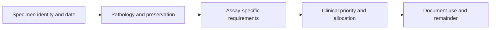

# Tissue and sample requirements

**You will be able to:** Explain why specimen preservation determines which tests remain possible.

A sample is not a generic unit of tissue. Its location, time of collection, viable-cell content, preservation and remaining quantity determine what can be learned from it. Reusing a digital dataset does not consume tissue; performing another extraction can.

**Before starting:** [What multi-omics measures](/wiki/education/reading-a-tumor/omics-and-multi-omics).

## Preserve the distinction

| Material | Often useful for | Important limit |
|---|---|---|
| Formalin-fixed, paraffin-embedded (FFPE) tissue | Histology, immunohistochemistry and validated molecular assays | It does not provide living cells for culture |
| Snap-frozen tissue | DNA, RNA and selected protein assays | Freezing without viable-cell preservation is not the same as banking living cells |
| Viably cryopreserved cells or tissue | Some culture and cell-based experiments after recovery | Viability, population composition and method suitability must be checked |
| Fresh tissue | Dissociation, cultures and selected immune experiments | Time, transport medium and processing conditions matter |
| Blood or leukapheresis material | Germline comparison, immune profiling or product-specific cellular manufacture | It is not a substitute for tumor tissue or proof of tumor-reactive cells |
| Plasma | cfDNA (cell-free DNA) and ctDNA (circulating tumor DNA) testing | Amount, handling, timepoint and assay sensitivity affect interpretation |

## Quantity is not enough

A large post-treatment tumor bed can contain few viable cancer cells. Fibrosis, normal epithelium and immune cells contribute material without answering every tumor question. A small specimen may be useful for one assay and unsuitable for another.

Single-cell RNA sequencing usually needs appropriately preserved cells; single-nucleus methods can use some frozen tissues. Their outputs and biases differ. An archived snap-frozen core cannot automatically be thawed into a viable organoid or used for cell-therapy manufacture.

## A specimen ledger

*Record the physical material and its custody separately from the data produced.*

Useful fields include specimen identifier, anatomical site, treatment exposure at collection, preservation, tumor content, quantity, location, consent and prior use. Confirm assay requirements with the receiving laboratory. Universal “one core” or “reserve 40%” rules are inappropriate when methods and specimens differ.

Clinical diagnostic needs take priority. Research allocation requires coordination with pathology and the applicable consent and protocol. A generic lesson cannot promise a future surgical yield or supply a current shipping plan.

## Try it

One laboratory asks for DNA and another for living cells. Can a paraffin block serve both?

**Explain it back:** It may support a validated DNA assay, but fixation removes the living-cell option. The second laboratory needs a suitable fresh or viably preserved source.

## Explain it back

Match preservation, content and custody to the actual assay. A saved specimen preserves some options, not every option.

## Takeaway

**Match preservation, content and custody to the actual assay. A saved specimen preserves some options, not every option.**

**Current logistics:** [Tissue and data](/wiki/care/tissue-and-data) holds the case-specific ledger; [the banking question](/wiki/questions/should-we-bank-leukopak) holds the actual decision.

## Sources

Checked October 8, 2026.

- [NCI: biospecimen resources and best practices](https://biospecimens.cancer.gov/bestpractices/).
- [Neal et al., immune organoid methods](https://pubmed.ncbi.nlm.nih.gov/30550791/) — method-specific viable tissue requirements.
- [NCI: T-cell transfer therapy](https://www.cancer.gov/about-cancer/treatment/types/immunotherapy/t-cell-transfer-therapy).
