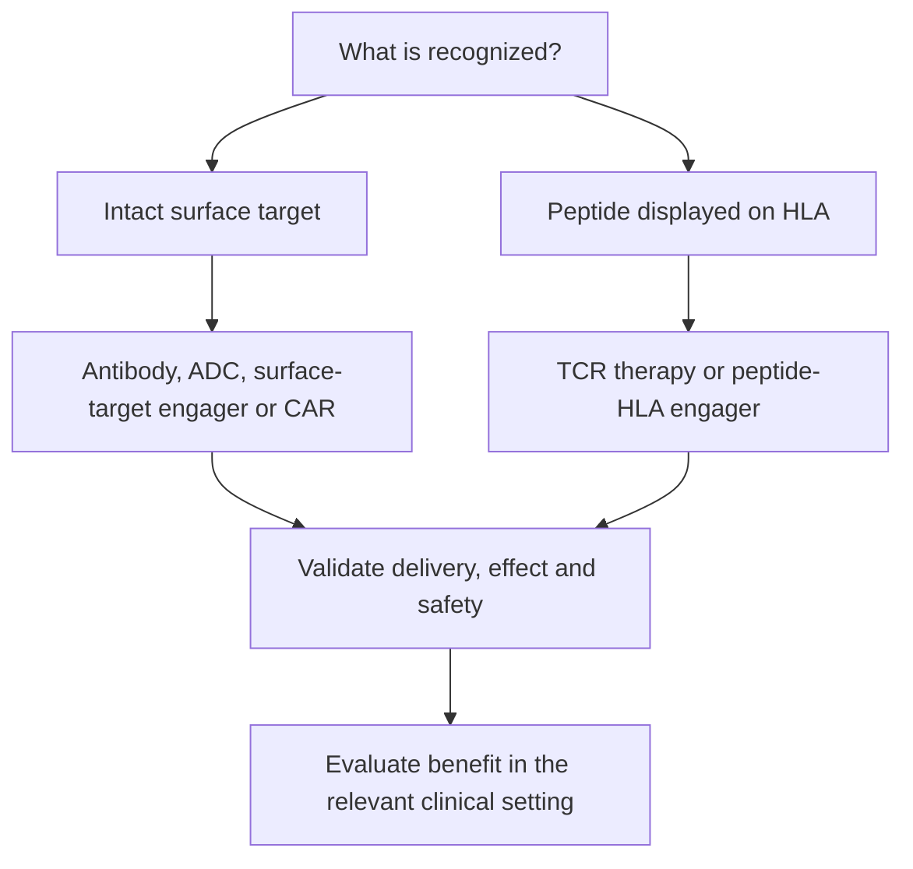

# Targeted therapy modalities

**You will be able to:** Separate what a therapy recognizes from how it acts and what evidence supports its use.

Two therapies can recognize the same protein and act differently. Two therapies can recruit T cells and recognize entirely different target types. Keeping recognition, drug format and clinical evidence separate makes comparisons much easier.

**Before starting:** [HLA](/wiki/education/concepts/immunology/antigen-presentation/hla) explains peptide presentation; [the immunotherapy guide](/wiki/education/guides/how-the-immune-system-fights-cancer/index) introduces the relevant cells and checkpoints.

## The map

*Target type, therapeutic format and clinical use are separate decisions.*

## Lessons

| Question | Lesson |
|---|---|
| What does each format do? | [Mechanism](/wiki/education/targeted-therapy-modalities/01-mechanism) |
| What determines readiness and duration? | [Timing](/wiki/education/targeted-therapy-modalities/02-timing) |
| What can be developed or given together? | [Overlap and sequencing](/wiki/education/targeted-therapy-modalities/03-overlap-and-sequencing) |
| How do I assess a proposal? | [Decision questions](/wiki/education/targeted-therapy-modalities/04-decision-questions) |
| Which specimens support which experiments? | [Tissue and sample budget](/wiki/education/targeted-therapy-modalities/05-tissue-and-sample-budget) |
| Which comparisons are easy to confuse? | [Comparisons](/wiki/education/targeted-therapy-modalities/06-comparisons) |

## The big ideas

**A target is not a dependency.** A surface protein can help a drug enter a cell without being a growth driver. Its presence also does not show that an antibody can reach it or spare normal tissue.

**HLA (human leukocyte antigen) independence is specific to recognition.** A surface-target CAR (chimeric antigen receptor) or antibody engager can recognize its target without peptide display on HLA. A TCR (T-cell receptor)-based engager still requires its particular peptide–HLA target. Neither format automatically overcomes poor T-cell function, failed trafficking or suppression in the tumor.

**Availability is specific to the product and setting.** An approved therapy for one cancer does not establish an approved use in early TNBC. A laboratory binder is an experimental reagent until format-specific engineering, manufacture, safety testing and a clinical pathway are established. One binder cannot be assumed to work unchanged in every format.

Local ablation has a different starting point: it destroys tissue without molecular target recognition. Its proposed systemic immune effects are a separate hypothesis, covered in [local-treatment modalities](/wiki/education/local-treatment-modalities/index).

## Try it

A proposal says, “This therapy recruits any T cell, so HLA loss cannot affect it.” What is missing?

**Explain it back:** The target-recognition arm. A surface-protein engager can be independent of HLA for recognition; a peptide–HLA engager cannot. Effective killing also depends on T-cell function, access and target expression.

## Explain it back

Name the target, recognition system, format, intended clinical setting and supporting evidence before comparing therapies.

## Takeaway

**Name the target, recognition system, format, intended clinical setting and supporting evidence before comparing therapies.**

## Applied to Diana

Treatment status belongs in [the care plan](/wiki/care/treatment-plan), unresolved choices in [questions](/wiki/questions/index), and provider-specific capabilities in [companies](/wiki/companies/index). A mechanism lesson does not establish eligibility or a treatment plan.

**Vocabulary:** ADC means antibody-drug conjugate.

## Sources

Checked October 8, 2026.

- [NCI: targeted therapy](https://www.cancer.gov/about-cancer/treatment/types/targeted-therapies).
- [FDA: tebentafusp mechanism review](https://www.accessdata.fda.gov/drugsatfda_docs/nda/2022/761228Orig1s000ChemR.pdf) — a TCR–CD3 engager recognizing gp100 peptide on HLA-A*02:01.
- [NCI: T-cell transfer therapy](https://www.cancer.gov/about-cancer/treatment/types/immunotherapy/t-cell-transfer-therapy).

## Concepts you will use

[[wiki/education/concepts/immunology/antigen-presentation/hla|HLA]] and [[wiki/education/concepts/evidence-and-statistics/biomarkers/actionability|clinical actionability]].

## What is still uncertain

Clinical benefit and combination safety require evidence for the actual product, population and setting. Mechanism alone cannot resolve those questions.
